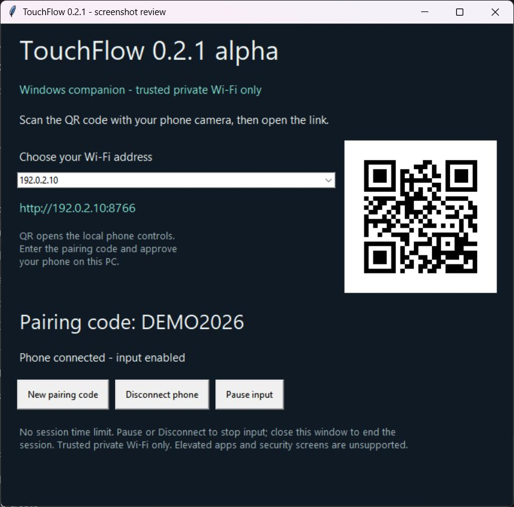

# TouchFlow

Use your phone as a wireless trackpad and keyboard for your Windows PC. Open the phone controls in a browser, pair locally, and control the active desktop application.

**Status: v0.2.1 alpha.** TouchFlow is an independent project by [Adarsh Prakasan](https://github.com/adarshprakasan). It is intended for trusted private networks and early feedback. Broad device compatibility and phone-to-PC operation have not yet been validated across a device matrix.

## Download and run

1. Go to **[Releases](https://github.com/adarshprakasan/TouchFlow/releases)** and download `TouchFlow-0.2.1-windows-x64.zip` from the alpha release assets.
2. Extract the ZIP into a folder on your Windows PC.
3. Run **TouchFlow.exe**. The portable build includes Python; you do not need to install it.
4. Connect your phone and PC to the same trusted private Wi-Fi network.
5. Scan the QR code in the companion with your phone camera and open the link. If needed, choose the PC Wi-Fi address in the dropdown; you can also enter the displayed address manually.
6. Enter the pairing code and approve your phone on the PC.

Keep the companion window open. Close it to stop the service. The executable is **unsigned**; Windows may show a reputation or publisher warning. Review the source and checksums and make your own trust decision. There is no installer or automatic updater.

**The connection uses unencrypted HTTP. Do not use public/shared Wi-Fi, forward port 8765, or send passwords or other sensitive text.** Pairing does not protect against someone who can intercept traffic on the network. See [Security](SECURITY.md).

## Screenshots

[Phone controller and pause-state screenshots](docs/SCREENSHOTS.md). Screenshots use an isolated review instance with example connection details.

## What changed in 0.2.1

- Fixed blocked button-release recovery, expired approvals, misleading paused status and numeric-validation overflow.
- Added regression tests for all four review findings.

Features introduced in 0.2.0:

- Local QR code and network-address selector for opening the phone controls.
- Double-tap-and-hold dragging, Safari text-selection prevention, and ordered mouse release after movement.
- No session expiry; reconnect automatically after temporary network interruption.

## Controls

| Control | Action |
| --- | --- |
| Slide one finger | Move the pointer |
| Tap the pad / Left click | Left click |
| Right click | Open the context menu |
| Tap, then tap again within 350 ms and slide while holding | Hold the Windows left button; lift your finger to drop a window/tab or finish a selection |
| Drag on, then slide | Hold the left button for dragging; tap Drag off to release |
| Slide two fingers vertically | Scroll |
| Pointer speed | Adjust movement sensitivity |
| Type and Send text | Send text to the active PC application |
| Special keys | Enter, Backspace, Tab, Escape and arrow keys |
| Desktop Pause / Disconnect | Stop input or revoke the phone session |

## Requirements and limitations

- Portable download: Windows 10 or 11 on x64. Other platforms are not supported in this release.
- Phone: a modern browser with JavaScript, touch/pointer events and Fetch support. iOS Safari and Android Chrome are intended targets; real-device coverage is pending.
- One phone and one PC on a reachable local network. Guest Wi-Fi isolation, VPNs or firewall rules may block the connection.
- Cannot control administrator applications, UAC dialogs, login/lock screens or the Windows security desktop.
- Approved sessions have **no idle or duration limit** while the companion runs. Temporary network loss retries automatically with the same session; queued input is discarded. Backgrounding/locking can suspend the browser, but does not expire pairing. Reloading/closing the tab or restarting the companion requires pairing again.
- No remote screen view, clipboard sync, file transfer, cloud relay, account or unattended access.

## Documentation

- [Getting started](docs/GETTING_STARTED.md) and [troubleshooting](docs/TROUBLESHOOTING.md)
- [Architecture and protocol](docs/ARCHITECTURE.md)
- [Build from source](docs/DEVELOPMENT.md) and [contributing](CONTRIBUTING.md)
- [Security policy](SECURITY.md), [privacy](PRIVACY.md) and [support](SUPPORT.md)
- [Changelog](CHANGELOG.md), [roadmap](docs/ROADMAP.md) and [release checks](docs/RELEASE_CHECKLIST.md)
- [Third-party notices](THIRD_PARTY_NOTICES.md)

## Run from source

Install Python 3.12 with Tk support on Windows, download the source ZIP and extract it, then run `py -3 -m pip install -r requirements.txt` in that folder. Double-click `Start TouchFlow.cmd`. Developers can instead use a virtual environment and run `python companion/touchflow.py`. The portable release bundles these dependencies.

The root `index.html` is a visual prototype only. The working phone controller is served by the Windows companion from `companion/phone.html`.

## License and feedback

TouchFlow source is licensed under the [MIT License](LICENSE). Bundled components retain their own licenses. Report reproducible problems in [Issues](https://github.com/adarshprakasan/TouchFlow/issues); follow the security policy for vulnerabilities.
