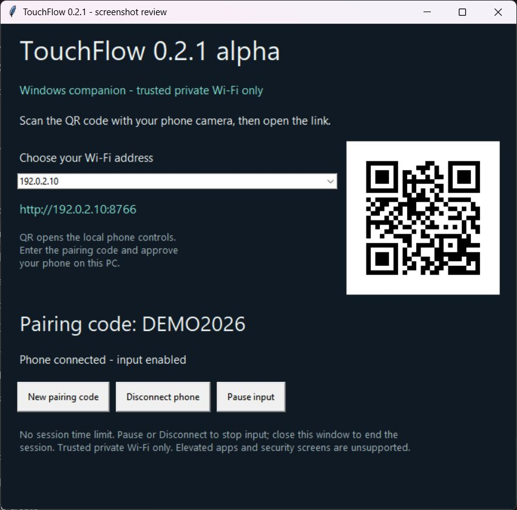
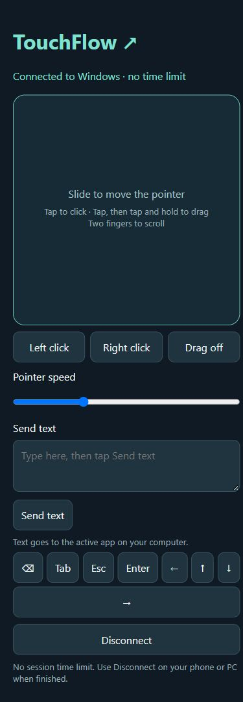
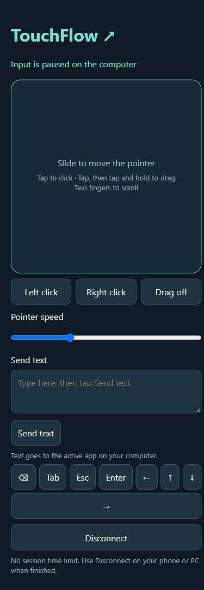

# TouchFlow screenshots

Captured from the running 0.2.1 app in an isolated local review instance. The companion uses documentation-only address `192.0.2.10`, port 8766 and sample code `DEMO2026`; these are illustrative values, not a connection to a user's computer. OS input was disabled in the review fixture. The phone interface was captured in a 390-pixel-wide browser viewport, not photographed on a physical handset. Images are screenshots of the actual UI, without generated artwork or retouching.

## Windows companion

QR connection link, address selection, pairing code and desktop pause/disconnect controls.

## Phone controls

Connected trackpad, click/drag buttons, sensitivity, text input and special keys.

## Pause status

The phone correctly shows that input is paused on the computer. This state was verified through the running desktop pause control and the phone heartbeat response.

The project MIT license applies to these UI screenshots. Use the latest release's actual address and fresh pairing code when connecting your own devices.
